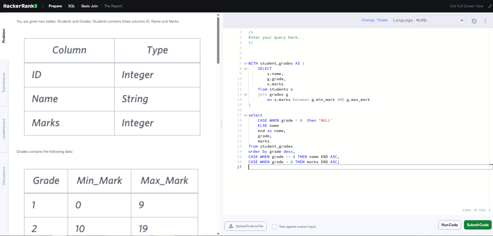
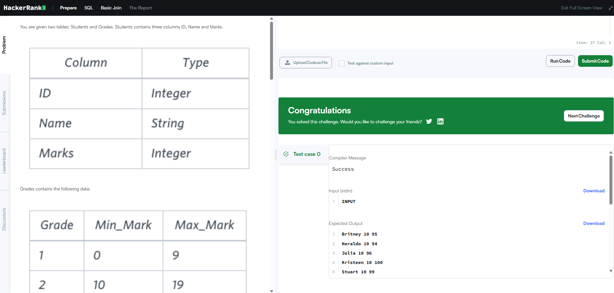
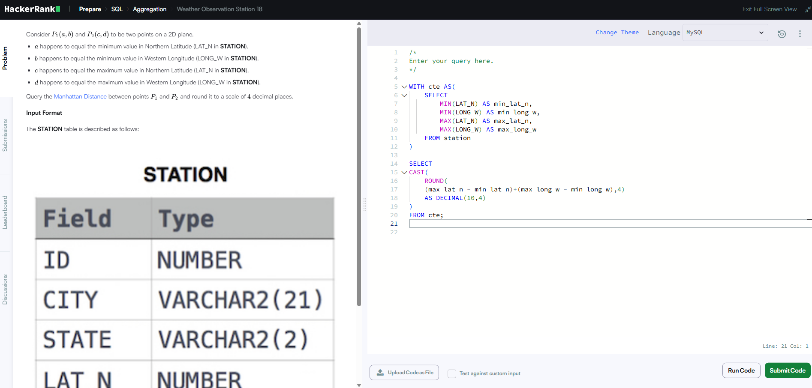
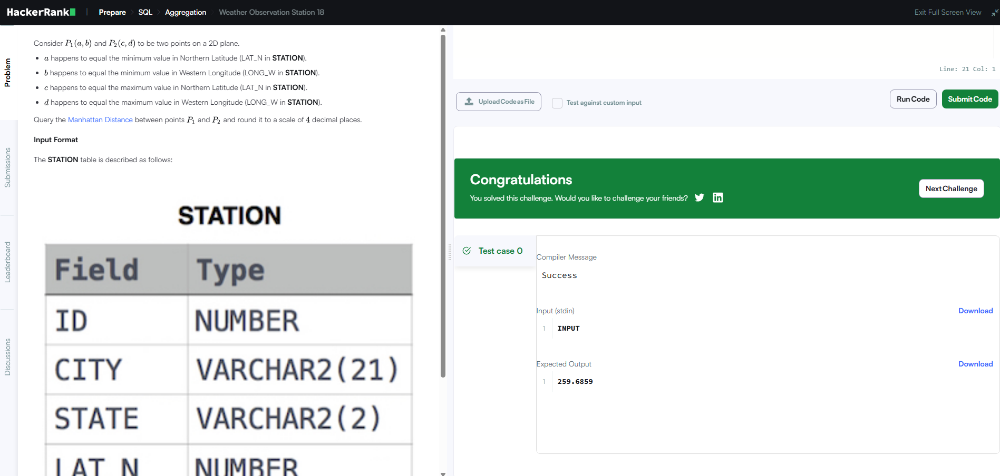
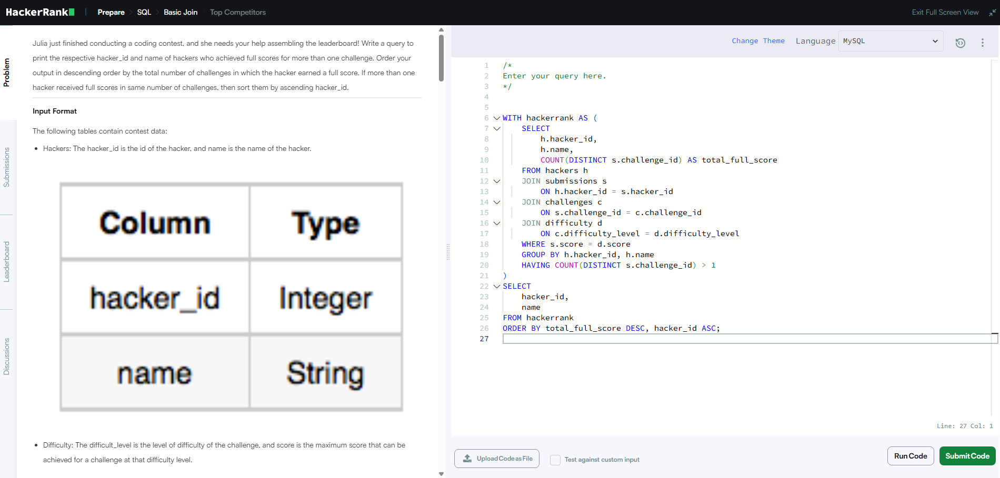
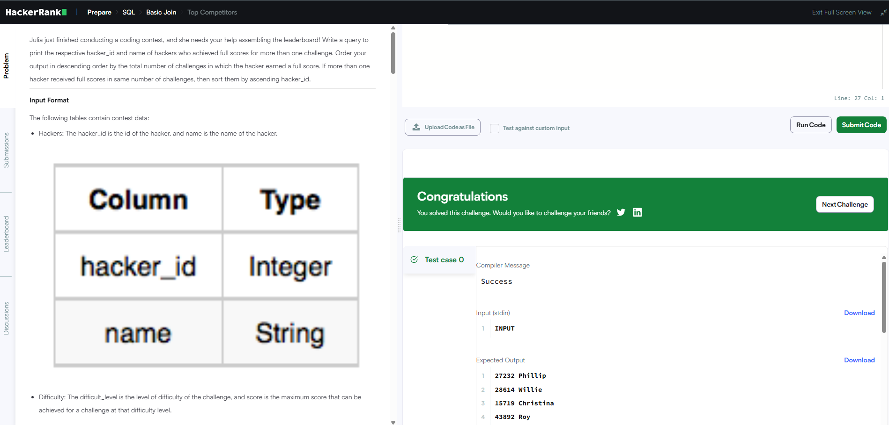
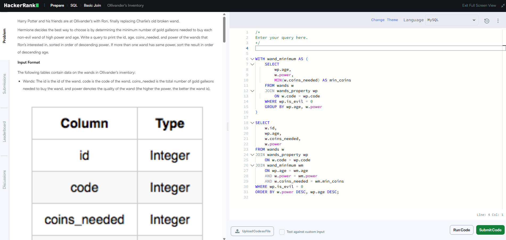
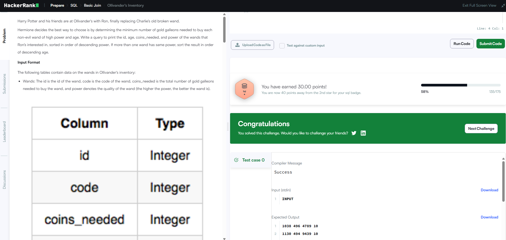
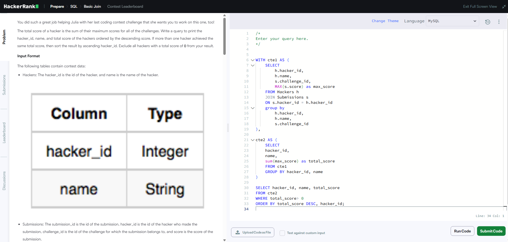
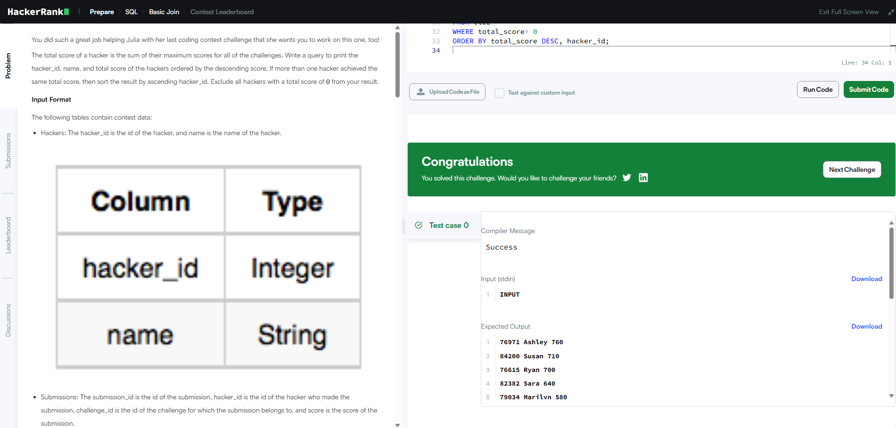

**Assignment Specialized SQL Techniques**

**Author:** Mohamad Alvan Zulfikhar  
**Program:** Dibimbing  
**Platform:** HackerRank

## Overview

This repository contains solutions and documentation for five SQL case studies from HackerRank as part of the Specialized SQL Techniques assignment.

The assignment focuses on modular query design using CTEs and subqueries, data aggregation, conditional logic, and window functions.


## Case Study 1: The Report

**Problem:** [HackerRank - The Report](https://www.hackerrank.com/challenges/the-report/problem)

### Learning Objectives

- JOIN using BETWEEN.
- Conditional logic using CASE WHEN.
- Multi-column ORDER BY.
- Common Table Expression (CTE).

### Key Concepts
Join Students dengan Grades memakai BETWEEN pada marks ke min_mark..max_mark. CASE WHEN grade < 8 THEN NULL ELSE name END. ORDERBY grade DESC, name ASC, marks ASC.

### Langkah disarankan:
Buat CTE untuk memetakan tiap student ke grade (join rentang). Di select final, gunakan CASE untuk menampilkan NULL pada name jika grade < 8. Terapkan urutan seperti ketentuan.

### SQL Query

```sql
WITH student_grades AS (
    SELECT
        s.name,
        g.grade,
        s.marks
    FROM students s
    JOIN grades g
        ON s.marks BETWEEN g.min_mark AND g.max_mark
)

SELECT
    CASE
        WHEN grade < 8 THEN NULL
        ELSE name
    END AS name,
    grade,
    marks
FROM student_grades
ORDER BY
    grade DESC,
    CASE WHEN grade >= 8 THEN name END ASC,
    CASE WHEN grade < 8 THEN marks END ASC;
```

### Hasil Pengerjaan






2. Weather Observation Station
**Problem:** [HackerRank - Weather Observation Station](https://www.hackerrank.com/challenges/the-report/problem](https://www.hackerrank.com/challenges/weather-observation-station-18/problem?isFullScreen=true))

### Learning Objectives
 - Agregasi MIN/MAX
 - Manipulasi numerik
 - Format hasil.


### Key Concepts
Ambil min(lat_n), min(long_w), max(lat_n), max(long_w).
Hitung  
∣max(lat)−min(lat)∣+∣max(long)−min(long)∣
∣max(lat)−min(lat)∣+∣max(long)−min(long)∣
Casting presisi desimal 4 angka.

### Langkah disarankan:
Satu CTE untuk menghimpun empat nilai agregat. Baris final menghitung jarak Manhattan dan CAST(... AS DECIMAL(10,4)).

### SQL Query

```sql

WITH cte AS(
    SELECT
        MIN(LAT_N) AS min_lat_n,
        MIN(LONG_W) AS min_long_w,
        MAX(LAT_N) AS max_lat_n,
        MAX(LONG_W) AS max_long_w
    FROM station 
)

SELECT
CAST(
    ROUND(
    (max_lat_n - min_lat_n)+(max_long_w - min_long_w),4)
    AS DECIMAL(10,4)
)
FROM cte;
```

### Hasil Pengerjaan




## Case Study 3: Top Competitors

**Problem:** [HackerRank - Top Competitors](https://www.hackerrank.com/challenges/full-score/problem)

### Learning Objectives

- Multi-table JOIN.
- Data aggregation using COUNT().
- Filtering aggregated data using HAVING.
- Common Table Expression (CTE).

### Key Concepts

Dapatkan max_score setiap challenge dari tabel Challenges dan Difficulty. Hitung jumlah submission yang mencapai max_score untuk setiap hacker_id. Gunakan HAVING COUNT(*) > 1 untuk mengambil hacker yang memperoleh lebih dari satu full score. Join hasilnya dengan tabel Hackers untuk mendapatkan nama hacker.

### Langkah disarankan:

1. CTE-1: Peta challenge_id dan max_score dari tabel Challenges dan Difficulty.
2. CTE-2: Hitung COUNT(*) dari Submissions yang mencapai max_score per hacker_id menggunakan HAVING COUNT(*) > 1.
3. Join hasil agregasi dengan tabel Hackers untuk mengambil name.
4. Select final: tampilkan hacker_id dan name, kemudian ORDER BY count_max_score DESC dan hacker_id ASC.

### SQL Query

```sql

WITH hackerrank AS (
    SELECT
        h.hacker_id,
        h.name,
        COUNT(DISTINCT s.challenge_id) AS total_full_score
    FROM hackers h
    JOIN submissions s
        ON h.hacker_id = s.hacker_id
    JOIN challenges c
        ON s.challenge_id = c.challenge_id
    JOIN difficulty d
        ON c.difficulty_level = d.difficulty_level
    WHERE s.score = d.score
    GROUP BY h.hacker_id, h.name
    HAVING COUNT(DISTINCT s.challenge_id) > 1
)
SELECT
    hacker_id,
    name
FROM hackerrank
ORDER BY total_full_score DESC, hacker_id ASC;
```

### Hasil Pengerjaan




---

## Case Study 4: Ollivander's Inventory

**Problem:** [HackerRank - Ollivander's Inventory](https://www.hackerrank.com/challenges/harry-potter-and-wands/problem)

### Learning Objectives

- Multi-table JOIN.
- Window Function using MIN() OVER().
- PARTITION BY.
- Filtering based on minimum values.

### Key Concepts

Join tabel Wands dengan Wands_Property untuk mendapatkan atribut age, power, dan is_evil. Gunakan MIN(coins_needed) OVER (PARTITION BY age, power) untuk mencari biaya minimum pada setiap kelompok age dan power. Selanjutnya, ambil hanya wand dengan coins_needed yang sama dengan biaya minimum dan is_evil = 0.

### Langkah disarankan:

1. CTE: Gabungkan tabel Wands dan Wands_Property.
2. Gunakan WHERE is_evil = 0 untuk menyaring wand yang tidak jahat.
3. Hitung MIN(coins_needed) OVER (PARTITION BY age, power) sebagai coins_min.
4. Select final: filter coins_needed = coins_min.
5. Urutkan berdasarkan power DESC dan age DESC.

### SQL Query

```sql

WITH hackerrank AS (
    SELECT
        h.hacker_id,
        h.name,
        COUNT(DISTINCT s.challenge_id) AS total_full_score
    FROM hackers h
    JOIN submissions s
        ON h.hacker_id = s.hacker_id
    JOIN challenges c
        ON s.challenge_id = c.challenge_id
    JOIN difficulty d
        ON c.difficulty_level = d.difficulty_level
    WHERE s.score = d.score
    GROUP BY h.hacker_id, h.name
    HAVING COUNT(DISTINCT s.challenge_id) > 1
)
SELECT
    hacker_id,
    name
FROM hackerrank
ORDER BY total_full_score DESC, hacker_id ASC;
```

### Hasil Pengerjaan





---

## Case Study 5: Contest Leaderboard

**Problem:** [HackerRank - Contest Leaderboard](https://www.hackerrank.com/challenges/contest-leaderboard/problem)

### Learning Objectives

- Multi-level aggregation.
- MAX() and SUM() functions.
- GROUP BY.
- JOIN operations.
- Filtering aggregated results using HAVING.

### Key Concepts

Gunakan MAX(score) untuk mendapatkan nilai tertinggi setiap hacker pada setiap challenge. Selanjutnya, jumlahkan seluruh nilai maksimum tersebut menggunakan SUM() berdasarkan hacker_id. Join dengan tabel Hackers untuk mendapatkan nama hacker. Gunakan HAVING SUM(max_score) > 0 untuk menghilangkan hacker dengan total skor nol.

### Langkah disarankan:

1. CTE-1: Hitung MAX(score) per hacker_id dan challenge_id dari tabel Submissions.
2. CTE-2: Join hasil agregasi dengan tabel Hackers untuk mendapatkan name.
3. Select final: Hitung SUM(max_score) sebagai score berdasarkan hacker_id dan name.
4. Gunakan HAVING SUM(max_score) > 0.
5. Urutkan berdasarkan score DESC dan hacker_id ASC.

### SQL Query

```sql
WITH cte1 AS (
    SELECT 
        h.hacker_id,
        h.name,
        s.challenge_id,
        MAX(s.score) as max_score 
    FROM Hackers h 
    JOIN Submissions s 
    ON s.hacker_id = h.hacker_id 
    group by 
        h.hacker_id, 
        h.name, 
        s.challenge_id
), 

cte2 AS (
    SELECT 
    hacker_id,
    name, 
    sum(max_score) as total_score 
    FROM cte1 
    GROUP BY hacker_id, name
)

SELECT hacker_id, name, total_score 
FROM cte2 
WHERE total_score> 0 
ORDER BY total_score DESC, hacker_id;
```

### Hasil Pengerjaan




